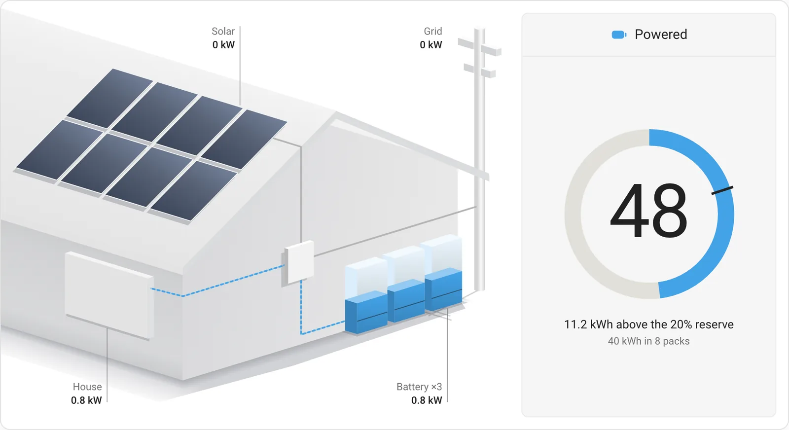
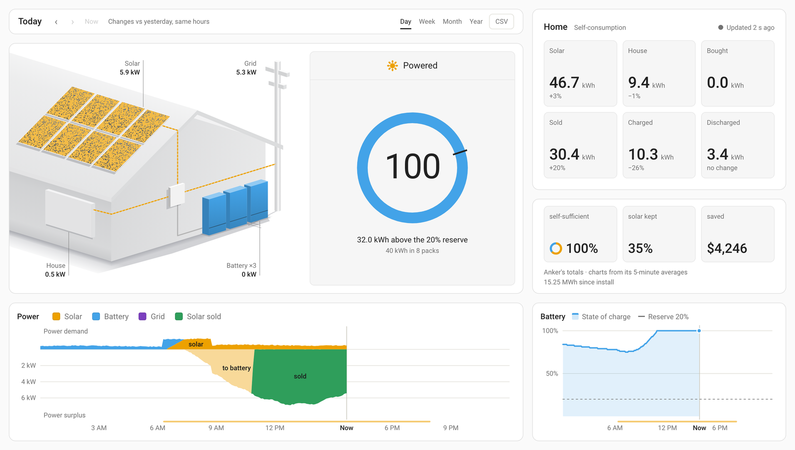
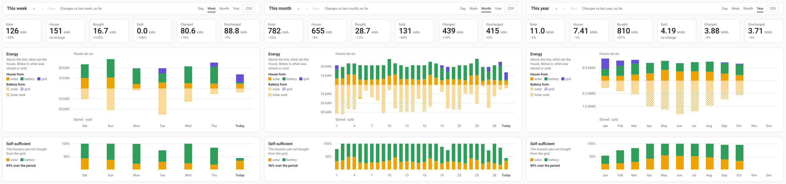
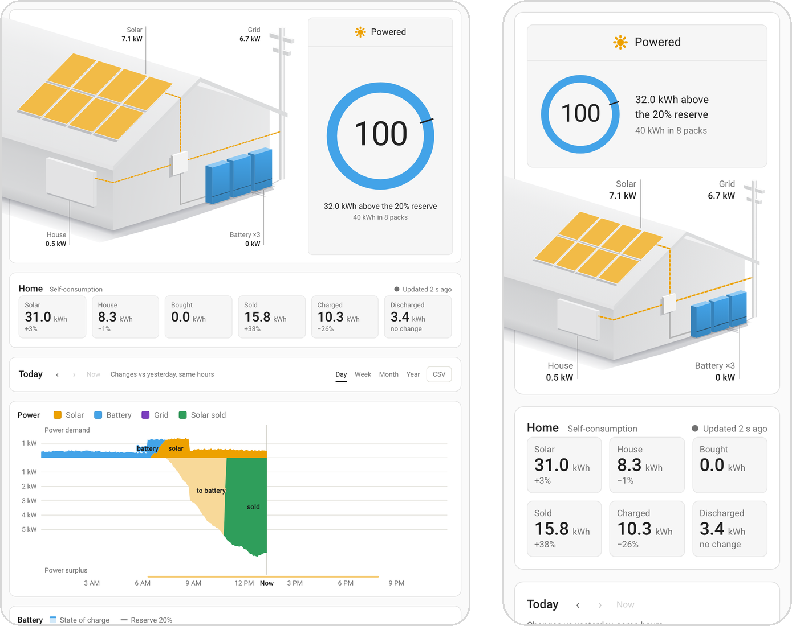

# Solix X1 Card

**Your Anker SOLIX X1 home battery system on one screen in Home Assistant:** the battery and its reserve, the home's power drawn as it flows, and Anker's own figures for the day, the week, the month and the year.

[](https://hacs.xyz) [](https://github.com/Treehouse-00/solix-x1-card/releases/latest) [](LICENSE)

<picture>
  <source media="(prefers-color-scheme: dark)" srcset="images/hero-dark.webp">
  
</picture>

**[Try it in your browser →](https://treehouse-00.github.io/solix-x1-card/demo/)** An invented home, no Home Assistant needed.

## At a glance

- **The battery first.** Its charge in a ring that marks your backup reserve, with the energy above or below it.
- **The home, drawn.** Solar, the battery, the grid and the house as one drawing. Each line takes the colour of the power on it and drifts the way it goes, faster as it carries more, and the panels light pixel by pixel with what the array makes.
- **Anker's own figures.** The day, the week, the month and the year from the cloud's statistics, the same as the Anker app's, each compared fairly with the period before.
- **Any moment.** Hover, drag a finger or use the arrow keys across either chart to read both at that moment, and download any period as CSV.
- **Any screen.** A laptop sees all of it without scrolling; a tablet or a phone gets the same cards, stacked. Light and dark follow your theme.
- **Private.** It runs in your browser against your own Home Assistant and makes no outside requests.

<picture>
  <source media="(prefers-color-scheme: dark)" srcset="images/dark.png">
  
</picture>

## Reading it

- **One colour per source, everywhere:** solar amber, the battery blue, the grid violet; solar sold is green.
- **The drawing.** "Powered" names the sources feeding the house; its full sentence (such as "Running on solar, charging the battery.") is its tooltip and what a screen reader says. The panels' lit share is the array's output over the most it makes. Each battery tower fills with the charge, and the mark across it is the reserve.
- **The power chart.** Above the line, what the house used, in the colour of what met it; below it, what charged the battery and what was sold. The week, the month and the year show a bar for each day or month.
- **The figures.** Six headline totals (solar, house, bought, sold, charged, discharged) with the change against the previous period, then the period's self-sufficiency, how much solar was kept, and what was saved.
- **The dot by the place's name** says how fresh the live figures are: solid while they are current, dashed after ten minutes, hollow when the cloud cannot be reached. Old figures are then said in the past tense, and the flow stops.

<picture>
  <source media="(prefers-color-scheme: dark)" srcset="images/ranges-dark.png">
  
</picture>

<p align="center">
  <picture>
    <source media="(prefers-color-scheme: dark)" srcset="images/screens-dark.png">
    
  </picture>
</p>

## Requirements

- Home Assistant 2025.12 or newer, which the Anker Solix integration requires. The card was developed and tested on 2026.10.
- The [Anker Solix integration](https://github.com/thomluther/ha-anker-solix) by Thomas Luther, set up with the account that owns the X1 system. The card was tested with version 3.9.1. It finds the Backup Controller's live sensors, the site's totals and the account's **API usage** switch by itself.
- The history comes from Anker's cloud through the integration's `anker_solix.api_request` action, so every view shows the Anker app's own figures from the day the system was installed. A change of view asks for at most eight answers, and periods that are over are kept for the session.

## Install

[](https://my.home-assistant.io/redirect/hacs_repository/?owner=Treehouse-00&repository=solix-x1-card&category=plugin)

### HACS

1. In HACS, open the menu (⋮) and choose **Custom repositories**.
2. Add `https://github.com/Treehouse-00/solix-x1-card` with the type **Dashboard**.
3. Find **Solix X1 Card** in HACS, download it, and reload your browser.

### Manual

1. Download `solix-x1-card.js` from the [latest release](https://github.com/Treehouse-00/solix-x1-card/releases/latest) into your `config/www/` folder.
2. In **Settings → Dashboards → ⋮ → Resources**, add `/local/solix-x1-card.js` as a **JavaScript module**.
3. Reload your browser.

## Configuration

Add the card from the dashboard editor: it appears as **Solix X1 Card**, finds your system, and offers every option as a form field. In YAML, the card is designed for a full-width **panel** view, where it fits the screen:

```yaml
views:
  - title: Solar
    type: panel
    cards:
      - type: custom:solix-x1-card
        reserve: 20
```

With one X1 system, that's all it needs. The options:

| Option | Default | What it does |
|---|---|---|
| `reserve` | `20` | The backup reserve, in percent, as set in the Anker app. Anker's cloud does not report it, so the card draws what you enter. |
| `name` | `Home` | A place name to head the place's column. |
| `view` | `day` | The view to open on: `day`, `week`, `month` or `year`. Each viewer's last choice is remembered in their browser. |
| `rate_import`, `rate_export` | — | What you pay for a kWh bought and are paid for one sold, in your home's currency. With a rate, the card prices what each period saved; without one, it shows Anker's lifetime saving. |
| `capacity_kwh` | found automatically | The battery's capacity. The card multiplies the site's module count by one module's capacity; set it if that is wrong. |
| `array_kw` | the best of the last 30 days | The most your array makes, in kW: every pixel on the drawn panels lights at this power. Its best clear-day output at noon is a good figure, and Anker's day history shows it; the panels' rating overstates it, so they would never fill. Left empty, the card uses the best five minutes it has seen in the last 30 days, which follows the seasons. |
| `site` | found automatically | The Anker site id, if the card cannot find it from the integration's site device. |
| `entities` | — | Overrides for renamed entities, for example `entities: { state_of_charge: sensor.my_x1_state_of_charge }`. The live keys are `state_of_charge`, `solar_power`, `home_demand`, `grid_import`, `grid_export`, `charge_power`, `discharge_power`, `data_time` and `cloud_state`; the site's are `site_battery_modules`, `site_yield_total`, `site_cost_savings` and `site_connection`; `account` is the integration's API usage switch. |

## Troubleshooting

- **"Anker's cloud didn't answer."** The history comes through the integration's `anker_solix.api_request` action: check that the integration is connected with the account that owns the system and that its **API usage** switch is on. While a period is running the card tries again every five minutes; for a past one, choose the period again.
- **"No Anker site found."** Set `site` to your site's id.
- **The panels never fill, or are always full.** Set `array_kw` to your array's best clear-day output.
- **The reserve or the battery's size is wrong.** Set `reserve` to the value in the Anker app, or `capacity_kwh` to the battery's size.
- **The charts add up to a little less than the figures.** That is expected: the figures are Anker's totals and the charts its 5-minute averages, and the foot of the screen says so.
- **A sensor was renamed.** Point the card at it with `entities`.

## How it counts

- **One set of flows.** Solar is split into what the house took, what the battery stored and what was sold, and the house's use into what came from solar, the battery and the grid. Both sums hold in every view, the CSV included.
- **Honest comparisons.** A period still running is compared with the same part of the previous one, not with the whole of it. A change against a very small figure is shown as a difference in kWh rather than a percentage.
- **Data age.** The live figures are the cloud's 5-minute averages, which the integration polls once a minute. The card makes no claim about the grid's state, since the cloud does not report it.
- **Privacy.** Everything runs in your browser against your own Home Assistant. The card makes no outside requests: the history reaches it from Anker's cloud through the integration, with the account the integration already uses.

## Accessibility and motion

- **Keyboard and screen readers.** Each chart takes focus and reads its values with the arrow keys; the drawing and the line of sources carry labels in words.
- **Motion.** A change of view crossfades, a figure that changes crossfades in place, and beads drift along the lines that carry power; nothing ever moves the layout. All of it is off when the viewer's system asks for reduced motion.
- **High contrast.** Under forced colours (Windows High Contrast, for one) the charts, the drawing and the battery ring keep their own colours, since colour is what they say; everything else follows the system. A request for more contrast darkens the secondary text and the grid.

Not affiliated with Anker Innovations. Anker and SOLIX are their trademarks.

## License

[MIT](LICENSE)
