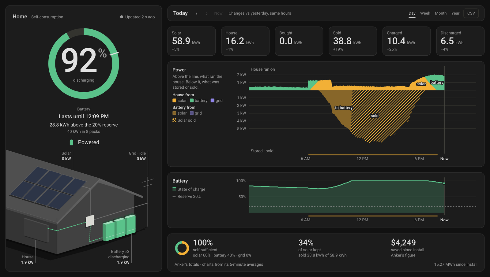

# Solix X1 Card

A Home Assistant dashboard card for the Anker SOLIX X1 home battery system. It shows the battery and its reserve, what the house is running on right now, a drawing of the home with its power flowing, and the Anker cloud's own statistics for the day, the week, the month and the year. On a laptop it fits one screen without scrolling.

**[Try it in your browser](https://treehouse-00.github.io/solix-x1-card/demo/)** with an invented home, no Home Assistant needed.




## What it shows

- **Battery.** The state of charge in a ring that carries the backup reserve, and what it means before anything else: "Lasts until 3:08 AM", "Full by 10:14 AM", "Not full today", or "Kept for outages" when only the reserve is left. Under it, the energy above or below the reserve and the battery's size.
- **Now.** What the house runs on at a glance, over a drawing of the home: an icon for each source feeding it, in its colour (the sun, the battery, a power plant for the grid), then "Powered". The full sentence, such as "Running on solar, charging the battery.", is its tooltip and what a screen reader says. The drawing shows eight panels on the roof, each a grid of 48 by 48 pixels that light at random in proportion to what the array is making, none at night and all at its best; the battery towers at the foot of the wall, each filling with the charge; a box on the long wall where the house's line ends; and the circuit through the X1. A line that carries power takes the colour of the energy on it, and beads drift along it the way the power goes.
- **The period.** For a day, a week, a month or a year: six headline figures (solar, house, bought, sold, charged, discharged) with the change against the previous period. A chart shows what ran the house above the line and what was stored or sold below it. A second chart shows the battery's charge through the day, or each day's self-sufficiency. Below the charts come the period's self-sufficiency, how much solar was kept, and what was saved. Hover, drag a finger across a chart, or use the arrow keys to read any moment, and download any period as CSV.


## Requirements

- Home Assistant 2025.12 or newer, which the Anker Solix integration requires. The card was developed and tested on 2026.10.
- The [Anker Solix integration](https://github.com/thomluther/ha-anker-solix) by Thomas Luther, set up with the account that owns the X1 system. The card was tested with version 3.9.1. It finds the Backup Controller's live sensors, the site's totals and the account's **API usage** switch by itself.
- The history comes from Anker's cloud through the integration's `anker_solix.api_request` action, so every view shows the Anker app's own figures from the day the system was installed. A change of view asks for at most eight answers, and periods that are over are kept for the session.

## Installation

### HACS

1. In HACS, open the menu (⋮) and choose **Custom repositories**.
2. Add `https://github.com/Treehouse-00/solix-x1-card` with the type **Dashboard**.
3. Find **Solix X1 Card** in HACS, download it, and reload your browser.

### Manual

1. Download `solix-x1-card.js` from the [latest release](https://github.com/Treehouse-00/solix-x1-card/releases/latest) into your `config/www/` folder.
2. In **Settings → Dashboards → ⋮ → Resources**, add `/local/solix-x1-card.js` as a **JavaScript module**.
3. Reload your browser.

## Configuration

Add the card from the dashboard editor: it appears as **Solix X1 Card**, finds your system, and offers every option as a form field. In YAML, the card is designed for a full-width **panel** view, where it fits the screen:

```yaml
views:
  - title: Solar
    type: panel
    cards:
      - type: custom:solix-x1-card
        reserve: 20
```

With one X1 system, that's all it needs. The options:

| Option | Default | What it does |
|---|---|---|
| `reserve` | `20` | The backup reserve, in percent, as set in the Anker app. Anker's cloud does not report it, so the card draws what you enter. |
| `name` | `Home` | A place name to head the left column. |
| `view` | `day` | The view to open on: `day`, `week`, `month` or `year`. Each viewer's last choice is remembered in their browser. |
| `rate_import`, `rate_export` | — | What you pay for a kWh bought and are paid for one sold, in your home's currency. With a rate, the card prices what each period saved; without one, it shows Anker's lifetime saving. |
| `capacity_kwh` | found automatically | The battery's capacity. The card multiplies the site's module count by one module's capacity; set it if that is wrong. |
| `array_kw` | the best of the last 30 days | The most your array makes, in kW: every pixel on the drawn panels lights at this power. Its best clear-day output at noon is a good figure, and Anker's day history shows it; the panels' rating overstates it, so they would never fill. Left empty, the card uses the best five minutes it has seen in the last 30 days, which follows the seasons. |
| `site` | found automatically | The Anker site id, if the card cannot find it from the integration's site device. |
| `entities` | — | Overrides for renamed entities, for example `entities: { state_of_charge: sensor.my_x1_state_of_charge }`. |

## Notes

- **One set of flows.** Solar is split into what the house took, what the battery stored and what was sold, and the house's use into what came from solar, the battery and the grid. Both sums hold in every view, the CSV included. The headline figures are Anker's own totals and the charts its 5-minute averages, which add up a little under them; the foot of the screen says so.
- **Honest comparisons.** A period still running is compared with the same part of the previous one, not with the whole of it. A change against a very small figure is shown as a difference in kWh rather than a percentage.
- **Data age.** The live figures are the cloud's 5-minute averages, which the integration polls once a minute. The dot beside the place name says how old they are. It turns dashed after ten minutes and hollow when the cloud cannot be reached; old figures are then said in the past tense, and the flow stops moving. The card makes no claim about the grid's state, since the cloud does not report it.
- **Privacy.** Everything runs in your browser against your own Home Assistant. The card makes no outside requests: the history reaches it from Anker's cloud through the integration, with the account the integration already uses.
- **Motion.** A change of view crossfades, a figure that changes crossfades in place, and beads drift along the lines that carry power; nothing ever moves the layout. All of it is off when the viewer's system asks for reduced motion.
- **High contrast.** Under forced colours (Windows High Contrast, for one) the charts, the drawing and the battery ring keep their own colours, since colour is what they say; everything else follows the system. A request for more contrast darkens the secondary text and the grid.

Not affiliated with Anker Innovations. Anker and SOLIX are their trademarks.

## License

[MIT](LICENSE)
